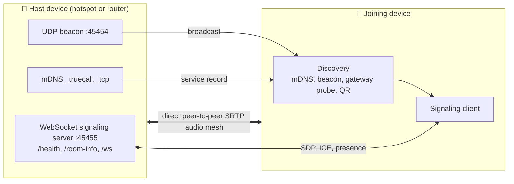

# 🎙️ TrueCalling


**Fully offline group voice calls over Wi-Fi and hotspot, for Android and iOS.** TrueCalling gives you low-latency, high-quality group calls where there's no cell coverage and no internet: camping trips, flights, disaster response, underground sites, or a gathering with a shared hotspot.

---

## ✨ Features

| | Feature |
|---|---|
| 📴 | **Zero internet.** Everything runs on the local network. No cloud signaling, STUN or TURN servers. |
| 📶 | **Hotspot or router.** One device runs a hotspot (Android or iOS Personal Hotspot), or everyone joins the same offline Wi-Fi router. |
| 📱 | **Android and iOS together.** Full interoperability between the two. |
| 🔎 | **Several discovery paths.** mDNS/Bonjour (`_truecall._tcp`), a UDP broadcast beacon (port `45454`) for networks that block multicast, a gateway fast-probe that finds a hotspot host in under 50 ms, and a QR code to join optically. |
| 👋 | **Device discovery and invites.** See nearby devices, call them directly, or create a named group and invite peers. Rooms can be protected with a PIN. |
| 🎧 | **Group mesh audio.** WebRTC full mesh with Opus at 32 kbps, forward error correction and discontinuous transmission, plus echo cancellation, automatic gain control and noise suppression. Deterministic offer and answer negotiation avoids glare. |
| 🔁 | **Auto-reconnect.** The call recovers after a network drop, with a reconnection banner. |
| 📊 | **Call stats** and a responsive participant grid with floating call controls. |
| 🔋 | **Keeps running in the background.** On Android, a foreground call service with Wi-Fi and wake locks. On iOS, a voice-chat audio session with background audio. |

---

## 🗺️ How it works



The host's embedded server only relays call setup messages. Audio flows directly between devices. The same TypeScript core (`core/`) powers the app on both platforms, wrapped in a thin native shell on each.

---

## 🧪 Develop

You need [Bun](https://bun.sh) and Node tooling.

```bash
bun install
bun run dev          # Vite dev server for the UI
bun test             # unit and integration tests
bun run typecheck    # strict TypeScript check
bun run build        # compile the core and build the web app
```

Try the engine without a phone using the CLI node simulator:

```bash
bun run core/cli/run_node.ts host --name "My Room" --pin 1234
bun run core/cli/run_node.ts join --name "Bob" --ip 127.0.0.1 --pin 1234
bun run core/cli/run_node.ts scan
```

### 📱 Mobile builds

The built web app is bundled into the native shells: a WebView on Android (`android/`) and a WKWebView on iOS (`ios/`). Android also runs an embedded device server in Kotlin. The [CI workflow](.github/workflows/ci.yml) type-checks, tests and builds everything on each push, packages an Android APK and an iOS project archive, and publishes them to a GitHub Release when you push a `v*` tag.

Release APKs are signed with a persistent upload key restored from repository secrets (`UPLOAD_KEYSTORE_B64`, `KEYSTORE_PASSWORD` and optionally `KEY_PASSWORD` and `KEY_ALIAS`). A tag build fails if the key isn't configured, so a release never ships with a throwaway signature. For local signed builds, put your own `keystore.properties` in `android/` (it's git-ignored).

---

## 🗂️ Project layout

```
core/                 shared engine
  signaling/          embedded WebSocket signaling server and client
  discovery/          mDNS, UDP beacon, gateway probe, device discovery
  webrtc/             mesh coordinator and Opus audio tuning
  cli/run_node.ts     host, join and scan from a terminal
ui/                   React UI: Home and Active Call screens and their components
android/, ios/        native app shells
platform/             reference native audio and service helpers
tests/                signaling, discovery, mesh and reconnect tests
```

Project state and next steps (CallKit and Android Telecom integration, field testing across Android and iOS hotspots) are in [HANDOFF.md](HANDOFF.md).
